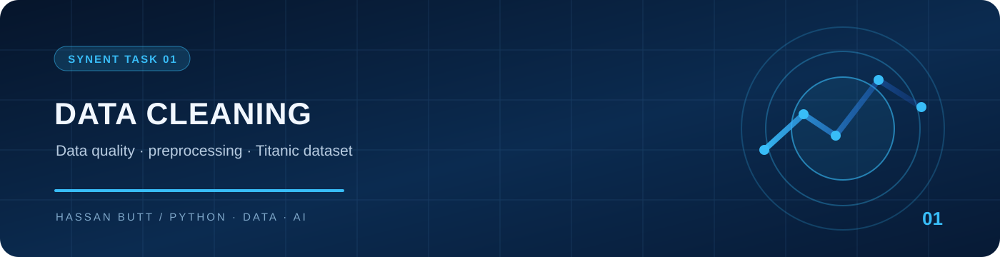
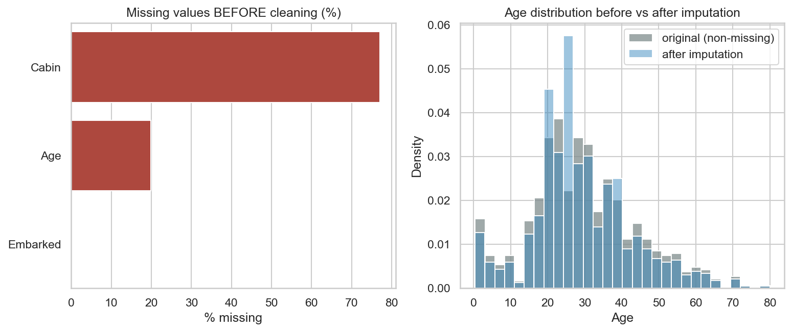

<p align="center"></p>
<p align="center"></p>
<p align="center"><a href="https://github.com/khnbutt118-dev">← Profile</a> · <a href="https://hassanbuttportfolio.vercel.app/">Portfolio</a> · <a href="https://www.linkedin.com/in/hassan-butt-ab0036334/">LinkedIn</a></p>

# 🧹 Titanic · Data Cleaning & Preprocessing
**Synent Technologies · Data Science Internship · Task 1**

<table><tr><td align="center"><h2>891</h2><sub>Rows retained</sub></td><td align="center"><h2>866 → 0</h2><sub>Missing cells</sub></td><td align="center"><h2>0</h2><sub>Duplicate rows removed</sub></td></tr></table>

## The transformation

| Data quality check | Before | After |
|:--|--:|--:|
| Rows | 891 | 891 |
| Missing cells | 866 | **0** |
| Duplicate rows removed | — | 0 |

## 🛠️ What changed

- Standardised column names to snake_case.
- Removed duplicate rows and duplicate passenger IDs (none were present).
- Imputed Age using median by passenger class and sex; Embarked using mode.
- Converted Cabin into `has_cabin` and `deck` features rather than imputing a column with 77% missing values.
- Corrected data types and generated a before/after quality report.

## 📈 Visual results

<p align="center"></p>
<p align="center"></p>

**Exploratory observation:** survival in this dataset was 74% for women and 19% for men. This is a descriptive result for this dataset, not a causal conclusion.

## ▶️ Run

```bash
pip install -r requirements.txt
python main.py
```

<details><summary><b>Dataset & files</b></summary>

- Dataset: [Titanic passenger dataset](https://www.kaggle.com/datasets/yasserh/titanic-dataset)
- 891 rows × 12 columns
- Outputs: `titanic_clean.csv`, `data_quality_report.json`
- Main files: `main.py`, `requirements.txt`, `outputs/`
</details>

---
<p align="center"><sub>Clean data is the foundation of reliable analysis.</sub></p>