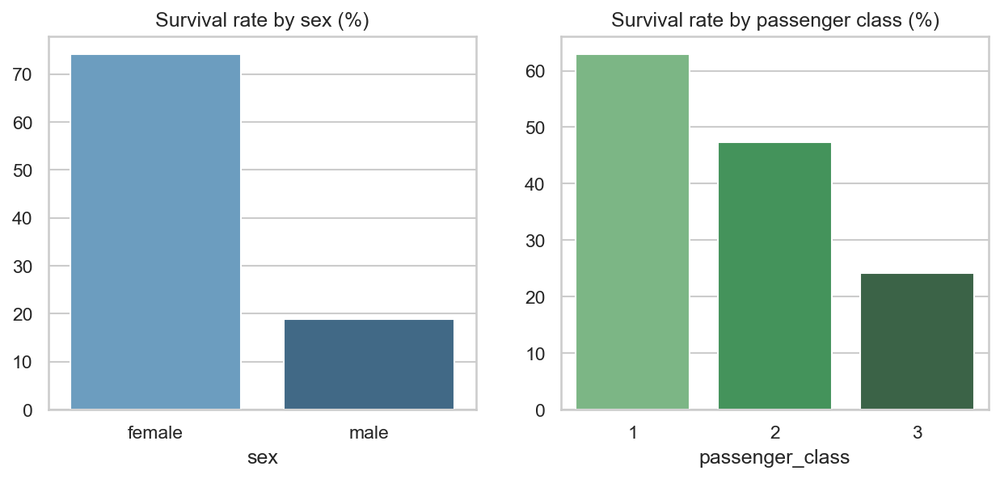

<p align="center"></p>

<p align="center"><a href="https://github.com/khnbutt118-dev">← Back to GitHub profile</a> · <a href="https://hassanbuttportfolio.vercel.app/">Portfolio</a> · <a href="https://www.linkedin.com/in/hassan-butt-ab0036334/">LinkedIn</a></p>

---

# Data Cleaning & Preprocessing (Titanic)

> Synent Technologies Data Science Internship | Task 1 (Basic level) | Author: Hassan Butt

## Problem statement
Raw data is rarely analysis-ready. This project cleans the Titanic passenger dataset so it can be analysed reliably.

## Dataset details
- **Dataset:** Titanic passenger dataset
- **Source:** https://www.kaggle.com/datasets/yasserh/titanic-dataset
- **Size used:** 891 rows x 12 columns

## Approach
1. Renamed columns to consistent snake_case names
2. Removed duplicate rows and duplicate passenger IDs
3. Handled missing values: Age (median by class and sex), Embarked (mode), Cabin (converted to has_cabin and deck features)
4. Converted data types (categories for class, sex, port, deck; integers for counts; floats for age and fare)
5. Created a before/after data-quality report and quick survival checks on the cleaned data

## Results
| Metric | Value |
|---|---|
| Rows (raw -> clean) | 891 -> 891 |
| Missing cells (before -> after) | 866 -> 0 |
| Duplicates removed | 0 |

**Key insights**

- Cabin was 77% missing, so it was converted into 'has_cabin' and 'deck' features instead of being imputed.
- Age was 20% missing and was filled with the median age of passengers in the same class and sex group.
- 0 duplicate rows were removed and all 866 missing cells were handled (0 left).
- After cleaning, survival was 74% for women vs 19% for men.

**Figures**




**Other output files:** `titanic_clean.csv`, `data_quality_report.json`

## How to run
```bash
pip install -r requirements.txt
python main.py
```

## Project structure
```
main.py            # full analysis / pipeline
requirements.txt
data/              # dataset (see data/README.md)
outputs/           # figures, tables and reports
```

## Academic integrity
All analysis code and write-ups in this repository were written by the author. The dataset belongs to its original creators (see link above).
